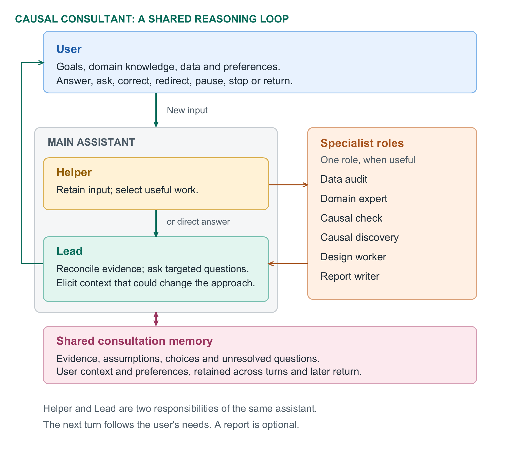

# Causal Consultant

An **interactive research skill** for developing causal questions, planning
studies, and interpreting evidence. It works with you through a conversation:
gathering context, exploring study designs, discussing useful next steps, and
revising recommendations as new information arrives.

## How the consultation works

- **Understand the study.** Clarify the research goal, intervention or exposure,
  population, outcomes, timing, and how treatment and data collection actually
  happen. This supports both planning a new study and assessing existing data.
- **Ask for context proactively.** Identify missing information that could change
  the design or interpretation. Ask for obtainable details, records, constraints,
  and preferences, and explain why they matter. Keep uncertainty explicit when
  information is unavailable.
- **Explore defensible approaches.** Consider plausible alternative explanations
  and different design or analysis routes. Explain their assumptions, tradeoffs,
  and what additional evidence could change the recommendation.
- **Develop the work together.** Discuss choices before undertaking scoped
  analysis or reporting. Adapt explanations to your background, respond to
  corrections, and keep the original scientific question in view.

You can ask for an explanation, provide partial information, change direction,
pause, or return later. Saved project memory retains relevant context, decisions,
findings, and unresolved questions. Replies stay concise, with clear answers,
questions, and next steps. A report is available when useful; it is optional.

## Start a conversation

Install the `causal-consultant` folder in your assistant's skills directory and
ask explicitly to use it. For example:

> Please use causal-consultant. We are planning a program evaluation and have not
> settled the study design. Help me clarify the causal question, identify the
> context you need, and compare feasible approaches before choosing an analysis.

You can also start with existing data, a study protocol, or a question about
interpreting results. Share what you know; the consultation should help identify
what else would be useful.

Node.js **18.18+** is required for local project memory. The memory utility has
no runtime package dependencies.

## Interactive testing

We use the companion [interactive-test skill](https://github.com/rqzhu-aide/interactive-test)
to evaluate Causal Consultant through adaptive, multi-turn conversations. A
simulated user follows a defined study scenario and user role, shares information
gradually, and responds to the consultant's questions and proposed choices.
Independent review examines the actual conversation and available evidence for
scientific reasoning, useful recommendations, and continuity across turns.

We constructed three groups of cases:

- **Reusable synthetic problems:** tutoring study design, observational
  difference-in-differences, treatment-effect heterogeneity and policy, and
  data-quality problems. Each can be paired with a typical user, a novice who
  presses for a preferred conclusion, or an expert who proposes alternatives.
- **Real-data investigation:** the RGGVY rural electrification study in
  Chhattisgarh, India, with a fixed Research Coordinator seeking a defensible
  household-welfare report.
- **Prospective study planning:** four fictional studies of a mask campaign in
  France, rural assistance and forest clearing in Peru, medication and depression
  in England, and surgical outcomes by surgeon gender in South Africa. These
  test feasible data collection and conditional analysis planning before outcomes
  exist, without requiring a numerical result or saved report.

The four reusable problems across three personas give 12 combinations; the five
standalone cases bring the total to **17 configurations**. See the
[tester README](https://github.com/rqzhu-aide/interactive-test#readme) for case
selectors, setup, and the interactive run steps.

## Further details

See [the skill instructions](SKILL.md), [method guidance](references/method-catalog.md),
and [project memory](references/memory.md). The skill distinguishes evidence from
assumptions and keeps limitations alongside causal claims; saved records and
successful computation do not by themselves establish scientific validity.

`main` contains the current release. Backup branches preserve earlier major versions.
